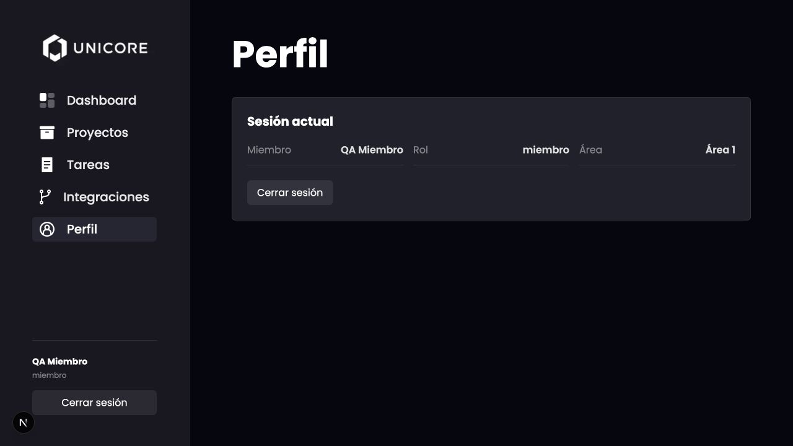
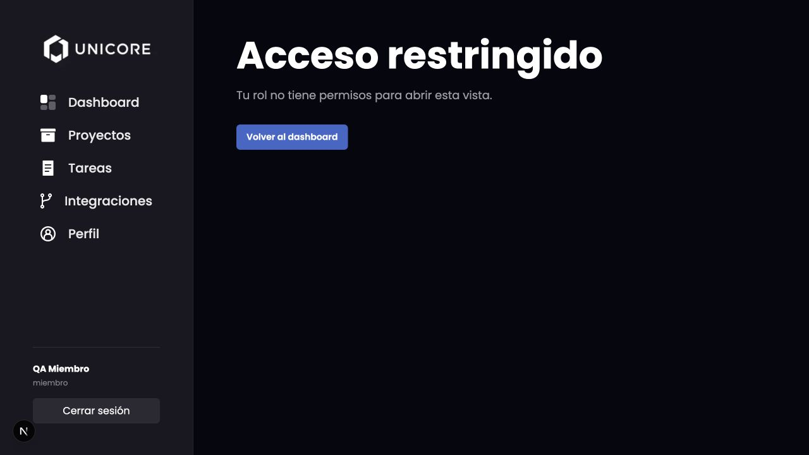
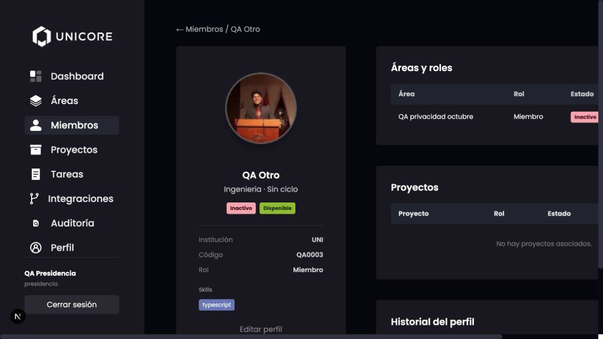

# Verificación local del 28 de octubre de 2026

Base comprobada: `main` `95cf6976bf21245e8f2619e76bb3a5274f8fbdaf`, con PR #114 y #115 fusionados.
Datos totalmente ficticios en PostgreSQL 16 desechable, puerto 55432; frontend 3300 y backend 3301.

## UNI2-74: privacidad por rol

- Miembro: inicio de sesión correcto siendo Inactivo (sin tareas activas). Perfil propio sin código UNI, competencias ni estados internos.
- Miembro: URL de perfil de otra persona muestra «Acceso restringido». `/members` devuelve 403.
- Miembro: `/auth/me` omite `studentCode`, `skills`, `activityStatus` y `availabilityStatus`.
- Presidencia: directorio `/members` incluye los cuatro campos internos; perfil de otra persona muestra código, skills, Inactivo y Disponible.
- Presidencia: `/auth/me` incluye código y estados; `skills` no se carga en este endpoint. Las competencias se verificaron en `/members` y perfil.
- Navegador sin errores de ejecución; advertencia preexistente de dimensiones del icono de integraciones.

## UNI2-75: corrida previa a las fusiones restantes

| Paso | Resultado del 28-oct |
| --- | --- |
| 1 | OK: SHA registrado y base vacía aislada. |
| 2 | OK: backend inició mediante migraciones; suite PostgreSQL verifica también reinicio sin pendientes. #109 todavía no estaba fusionado. |
| 3 | OK: bootstrap creó primera Presidencia y el login funcionó. |
| 4 | OK: área, dos miembros y proyecto creados mediante API; visibles en navegador. |
| 5 | Pendiente de fusión de #109: main aún crea Planning, Execution, Review, Launch. |
| 6 | Pendiente de fusión de #103. |
| 7 | Pendiente de fusión de #108. |
| 8 | OK: Miembro Inactivo inició sesión en navegador. |
| 9 | OK: privacidad por rol según evidencia anterior. |
| 10 | Pendiente de implementación/fusión de S4-B1. |

Controles sobre main: 328/328 pruebas backend, 60/60 frontend, 7/7 PostgreSQL;
type-check y lint de ambos correctos, build backend correcto.
La corrida del viernes 30 y la integración de los PR aún abiertos siguen pendientes;
este informe no las acredita anticipadamente.
